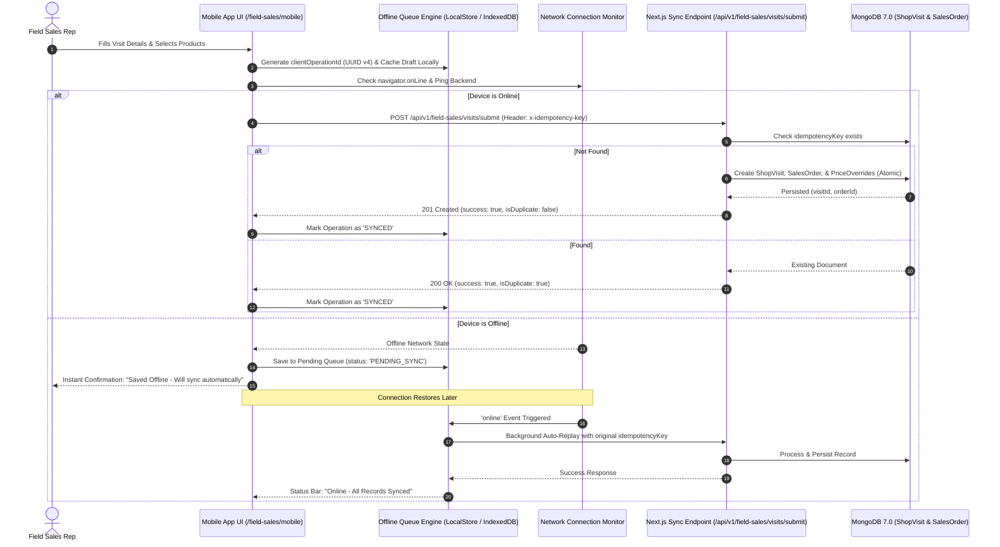

# APEX Electronics — Mobile Offline-First Synchronization Engine

## 1. Architectural Philosophy: Offline-First for Field Sales

Field sales representatives regularly visit electronics retail shops in underground basements, dense markets, or rural territories where cellular reception drops intermittently.

A traditional web app fails abruptly with network timeout errors in these conditions, resulting in lost orders, frustrated reps, and inaccurate inventory allocations.

APEX Electronics solves this with a **Zero-Data-Loss Offline-First Architecture**:
- All field sales actions (shop visits, product selections, photo captures, discount requests) are saved locally first.
- If connectivity is available, transactions sync instantly.
- If connectivity is unavailable, transactions are queued in local persistent storage and retried automatically the moment a cellular or Wi-Fi connection is restored.
- **Strict Idempotency** guarantees that network retries never create duplicate orders or bill double charges.



---

## 2. Core Components of the Offline Engine

### 2.1 The Client-Side Engine (`src/lib/offline-sync-engine.ts`)
The offline engine encapsulates four core mechanisms:
1. **Client Operation Identification**: Every draft generates an RFC4122 UUID v4 `clientOperationId` (e.g. `OP-1732085400-A7F9`).
2. **Persistent Queue Management**: Queued visits are stored with creation timestamp, payload, retry attempts, and last error message.
3. **Connectivity Watcher**: Uses browser `window.addEventListener('online')` and `navigator.onLine` combined with periodic health pings.
4. **Exponential Backoff**: If a sync attempt encounters a server 5xx error, it retries with an exponential backoff factor (1s, 2s, 4s, 8s, up to 60s) to prevent hammering the server.

### 2.2 The Atomic Server Sync Endpoint (`/api/v1/field-sales/visits/submit`)
The backend provides an atomic, single-step submission endpoint:
- **Header Check**: Reads `x-idempotency-key` from incoming request headers.
- **Deduplication Check**: Queries MongoDB `ShopVisit.findOne({ idempotencyKey })`. If matched, immediately returns the cached `visitId` with `isDuplicate: true`.
- **Sales Calculation**: Computes quantity totals, gross value, and identifies manual price overrides.
- **Atomic Persistence**: Writes `ShopVisit`, creates associated `SalesOrder`, and records `PriceOverride` requests within a single logical unit.

---

## 3. Data Structure: Offline Queue Item

```typescript
export interface OfflineQueueItem<T = any> {
  id: string;                    // Unique UUID for the queue entry
  clientOperationId: string;     // Idempotency key sent to the backend
  type: 'SHOP_VISIT' | 'ORDER_SUBMISSION' | 'RETAILER_REGISTRATION';
  payload: T;                    // Full JSON payload of the transaction
  createdAt: number;             // Epoch millisecond timestamp
  attempts: number;              // Current retry count
  status: 'PENDING' | 'SYNCING' | 'SYNCED' | 'FAILED';
  lastError?: string;            // Description of last failed attempt
}
```

---

## 4. Conflict Resolution Strategy

| Conflict Scenario | Resolution Logic | Audit Log Entry |
| :--- | :--- | :--- |
| **Duplicate Network Packet** | Backend returns existing record with `isDuplicate: true`. Queue item removed. | None (Clean deduplication). |
| **Catalog Price Updated While Offline** | Backend honors standard price at sync time, but records original rep entry as manual price override if price is lower. | `PRICE_MISMATCH_RECORDED` |
| **Shop Status Deactivated While Offline** | Backend accepts visit record for historical auditing, but holds sales order in `PENDING_APPROVAL` status. | `VISIT_LOGGED_DEACTIVATED_RETAILER` |
| **Simultaneous Orders Depleting Warehouse Stock** | Order moves to `BACKORDERED` status, alert sent to Warehouse Operations Manager. | `STOCK_ALLOCATION_SHORTAGE` |

---

## 5. User Interface Feedback (`AndroidSyncStatusBar`)

The mobile UI renders a persistent status bar (`<AndroidSyncStatusBar />`) that communicates real-time synchronization state to the field agent:

- **Online & Synced**: Emerald badge (`Online - Synced`), reassuring the rep that all store visits are securely backed up in the cloud.
- **Offline Mode**: Amber warning banner with draft counter (`Offline Mode (2 drafts pending)`).
- **Syncing in Progress**: Animated blue spinning indicator (`Syncing 2 offline visits to APEX Cloud...`).
- **Manual Trigger**: "Sync Now" button allowing the agent to force an immediate synchronization check whenever signal strength improves.
