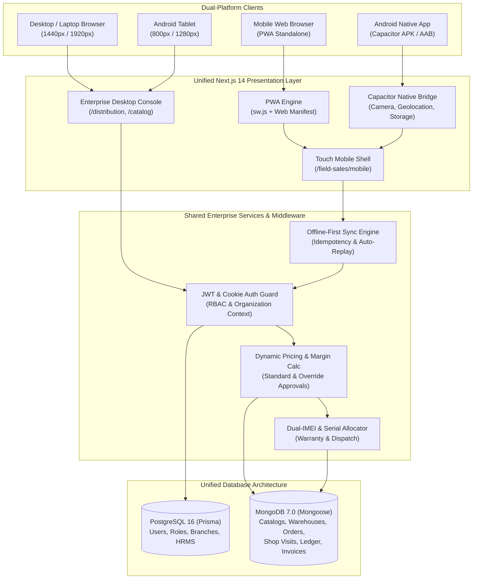

# APEX Electronics — Web + Android Dual-Platform Architecture

## 1. System Overview & Strategic Objective

APEX Electronics operates a mission-critical wholesale B2B distribution network supplying tier-1 mobile phones and electronics across retail partners, regional warehouses, and enterprise clients. 

To empower both corporate executive decision-makers and field sales agents navigating physical retail shops, APEX employs a **Single-Codebase, Dual-Platform Architecture**:

1. **Enterprise Desktop & Tablet Web**: Full 23-module management portal with double-entry ledgers, dual-IMEI tracking, warehouse logistics, BI analytics, real-time telemetry, and GSTR-1 tax compliance.
2. **Mobile Web & Native Android Application**: Fast, touch-first field sales interface with offline queueing, GPS shop verification, instant camera capture, thumbnail catalog browsing, and single-step idempotent submission.

---

## 2. Platform Comparison Matrix

| Capability | Desktop Web Console | Android Smartphone (App / PWA) | Android Tablet |
| :--- | :--- | :--- | :--- |
| **Primary Route** | `/distribution` | `/field-sales/mobile` | `/distribution` & `/catalog` |
| **Target Viewport** | 1280px – 1920px+ | 360px – 430px | 768px – 1280px |
| **Navigation Model** | Collapsible Sidebar + Cmd+K Header | Fixed Bottom Bar (5 Thumb-Zone Tabs) | Adaptive Responsive Grid |
| **Offline Capability** | Service Worker App Shell Caching | Full IndexedDB/Local Queue + Auto-Sync | Service Worker Shell Caching |
| **Hardware Integration** | File Picker Upload | Native Camera + GPS Geofencing | Native Camera + GPS Geofencing |
| **Operational Focus** | Warehousing, Invoicing, Ledger, Analytics | Retailer Visits, Fast Order Booking | Field Management, Catalog Showcase |
| **Packaging** | Standard Web URL | Native APK/AAB & Standalone PWA | Native APK/AAB & Standalone PWA |

---

## 3. Core Architectural Principles

### 3.1 Zero Logic Duplication
Unlike legacy approaches that build separate Android apps in Java/Kotlin or Flutter alongside a React web portal, APEX runs a **single unified codebase**:
- Shared TypeScript interfaces across client and server (`IShopVisit`, `ISalesOrder`, `IProduct`, `IRetailer`).
- Single set of Next.js REST API endpoints (`/api/v1/*`).
- Identical MongoDB models and business logic (e.g., GST calculation, price overrides, warranty lifecycle).

### 3.2 Dual Database Strategy
- **PostgreSQL 16 (via Prisma ORM)**: Strictly ACID-relational entities including User accounts, Role-Based Access Control (`SUPER_ADMIN`, `ADMIN`, `HR_MANAGER`, `SALES_REP`, `EMPLOYEE`), department hierarchies, shifts, and attendance logs.
- **MongoDB 7.0 (via Mongoose)**: High-throughput document storage for hardware catalogs, dual-IMEI records, retailer records, dynamic sales orders, payment collections, and geo-tagged shop visits.

### 3.3 Progressive Web App (PWA) + Capacitor Hybridity
- **Web Browsers**: The service worker (`public/sw.js`) intercepts network requests, pre-caches the static application shell, and provides seamless offline capabilities.
- **Android Runtime**: Apache Capacitor (`@capacitor/android`) wraps the verified web build inside a high-performance Android WebView (`MainActivity.java`), injecting native hardware bridges for camera, geolocation, network status, and notifications without requiring separate native codebases.

---

## 4. Security & Authentication Architecture

1. **Authentication Token Lifecycle**:
   - Access Tokens: Signed JWTs containing `userId`, `organizationId`, `role`, and `employeeId` with a 7-day expiration.
   - Refresh Tokens: Secure 30-day cryptographic tokens stored in database sessions.
   - Dual Delivery: Transported via HTTP-only secure cookies on desktop browsers, and via standard `Authorization: Bearer <token>` headers on Android native apps.

2. **Network Security**:
   - Cleartext HTTP enabled strictly for development testing (`cleartext: true` in `capacitor.config.ts` and `android:usesCleartextTraffic="true"` in `AndroidManifest.xml`).
   - Production enforces TLS 1.3 with strict HTTPS redirects and automated SSL certificate renewal.

3. **Runtime Geofencing**:
   - Every field sales visit checks the device's GPS latitude and longitude against the retailer's registered coordinates.
   - High-accuracy GPS threshold is enforced (< 25m accuracy), preventing location spoofing during order bookings.
